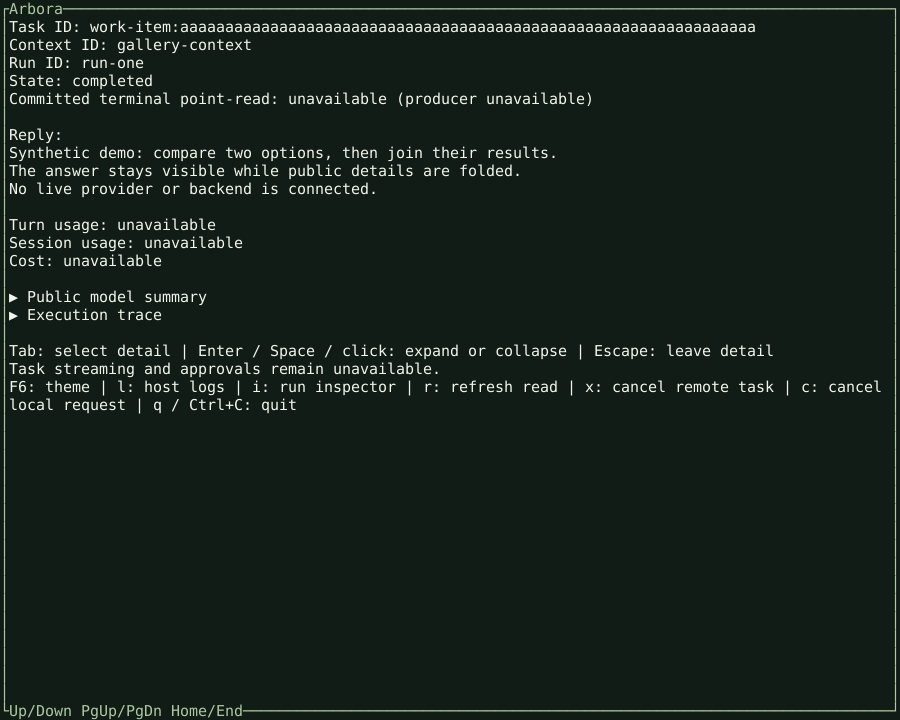

# agent-terminal-ui: tuig

`tuig` is the Rust/Ratatui terminal frontend for Arbora. There is one executable
and one UI implementation. The former Python/Textual frontend is retired.

## Native terminal preview



This capture shows the compiled Rust/Ratatui terminal with synthetic fixture data,
not the retired Python/Textual UI. It comes from source commit `a8952ff`.
See [all six native views and capture provenance](docs/screenshots.md).

The README uses the same committed asset as the gallery. CI validates asset
hashes; it does not automatically replace screenshots. See the
[screenshot refresh procedure](docs/screenshots.md#refreshing-the-gallery).

## Installation

The PyPI distribution is `agent-terminal-ui`; the installed command is `tuig`.
Native wheel availability and platform qualification are release requirements.
Do not assume a published older version already includes this cutover.

```sh
pip install agent-terminal-ui
tuig --help
```

## Connect

Arbora runs separately. Configure `AGENT_URL` and `AGENT_BEARER_TOKEN`.
Remote access requires TLS. For a deliberately anonymous loopback service, set
`AGENT_AUTH_MODE=none` and omit the bearer token.

```sh
tuig
tuig --prompt "Summarize the project"
tuig --observe-task TASK_ID
tuig --headless --prompt "Summarize the project"
tuig --headless --observe-task TASK_ID
```

The no-argument view discovers the configured agent, or reads `AGENT_TASK_ID`.
Prompt submission and task observation use Arbora A2A. Run inspection and logs
use served Arbora operations. Task/context/run identifiers remain distinct.

Headless execution prints validated unary snapshots and polls active tasks.
It exits unsuccessfully if input, approval or authentication is required, or
if the task fails, is canceled or is rejected. It never approves or cancels a
task. Its four-hour observation bound does not stop backend work.

## Current boundary

Native rendering includes task state, public output details, themes, keyboard
and mouse scrolling, run inspection and host logs. Remote cancellation in the
interactive view requires confirmation. `--observe-task` remains read-only.

With no selected task or prompt, `tuig` opens a one-task text composer.
Enter submits; Ctrl+J adds a newline; Escape reviews status and `p` returns
to the draft before submission. It never resubmits an unknown outcome.
Streaming, approval attachment, context continuation and durable resume
are not yet implemented. The removed Python frontend is not a fallback. `--override`, `--bg`, `--model` and `--session` are
rejected. Full served parity and release performance remain open in
[the runtime specification](specs/terminal-runtime/requirements.md).

See [architecture](docs/architecture.md), [configuration](docs/configuration.md)
and [development](docs/development.md). Historical Python source and screenshots
remain in git history, not in the live application.

## License

[MIT](LICENSE).
