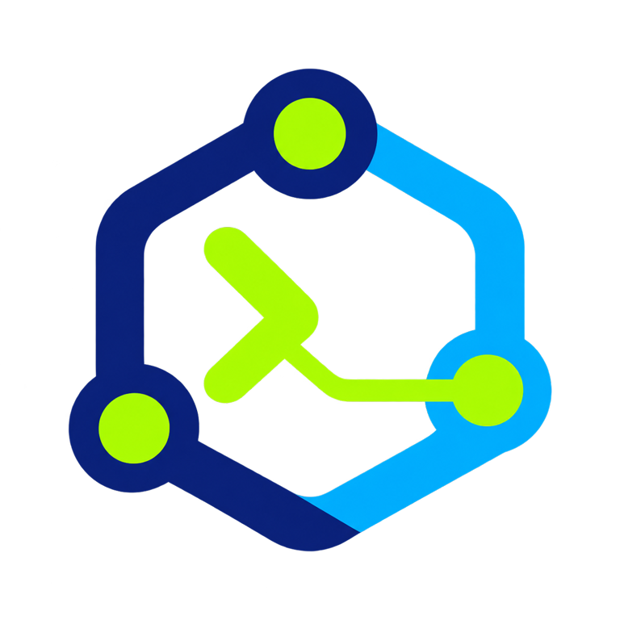
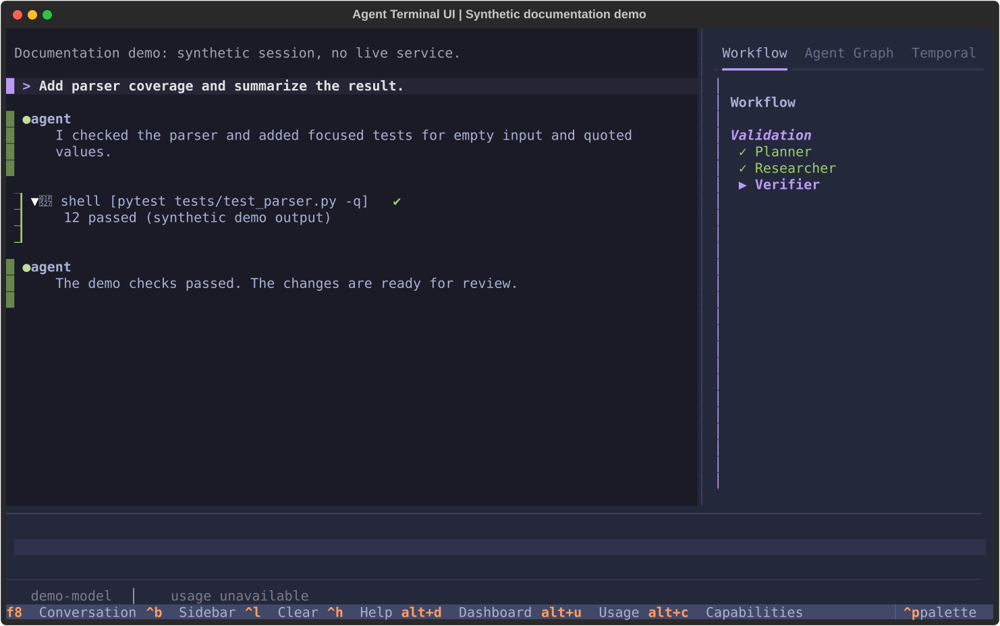

# Agent Terminal UI

<p align="center">
  
</p>

<p align="center">
  <b>The terminal frontend for Arbora agent sessions.</b><br>
  <sub>Arbora over A2A.</sub>
</p>

[](https://github.com/Knuckles-Team/agent-terminal-ui/stargazers)
[](https://github.com/Knuckles-Team/agent-terminal-ui/forks)
[](https://github.com/Knuckles-Team/agent-terminal-ui/graphs/contributors)
[](https://opensource.org/licenses/MIT)
[](https://github.com/Knuckles-Team/agent-terminal-ui/commits/main)
[](https://github.com/Knuckles-Team/agent-terminal-ui/issues)
[](https://github.com/Knuckles-Team/agent-terminal-ui)
[](https://pypi.org/project/agent-terminal-ui/)
[](https://pypi.org/project/agent-terminal-ui/)
[](https://github.com/Knuckles-Team/agent-terminal-ui/actions/workflows/pipeline.yml)
[](https://knuckles-team.github.io/agent-terminal-ui/)
[](https://github.com/astral-sh/uv)
[](https://github.com/astral-sh/ty)

<p align="center">
  <a href="https://knuckles-team.github.io/agent-terminal-ui/">Documentation</a> ·
  <a href="https://knuckles-team.github.io/agent-terminal-ui/architecture/">Architecture</a> ·
  <a href="https://knuckles-team.github.io/agent-terminal-ui/features/">Features</a> ·
  <a href="https://knuckles-team.github.io/agent-terminal-ui/configuration/">Configuration</a>
</p>

## Contents

- [Overview](#overview)
- [Screenshots](#screenshots)
- [Architecture](#architecture)
- [Key Capabilities](#key-capabilities)
- [Features](#features)
- [Installation](#installation)
- [Usage](#usage)
- [Development](#development)
- [Documentation](#documentation)
- [Contributing](#contributing)
- [License](#license)

## Overview

Built with [Textual](https://textual.textualize.io/).
Connects to [Arbora](https://knuckles-team.github.io/arbora/).
It connects to Arbora's A2A endpoint for task submission and observation.
Arbora runs separately from this frontend.

> [!NOTE]
> This library is in early development and subject to change.

## Screenshots



Synthetic demo captured from the real Python Textual app, not a live service or
the Rust native terminal. [Gallery and refresh command](docs/screenshots.md).

## Architecture

The Python console entry point selects interactive, headless or task-observer execution.
Interactive mode creates the Textual application. Headless mode creates no Textual widget tree.
Both paths use AgentClient for served requests. Arbora runs in a separate process.

| Component | Responsibility |
|---|---|
| [terminal_ui.py](agent_terminal_ui/terminal_ui.py) | Selects the entry path and validates arguments. |
| [app.py](agent_terminal_ui/app.py) | Coordinates interactive screens, input and client events. |
| [headless.py](agent_terminal_ui/headless.py) | Runs prompts or observes tasks and renders output without Textual. |
| [client.py](agent_terminal_ui/client.py) | Adapts A2A tasks and served operations into frontend results. |
| [screens/](agent_terminal_ui/screens/) and [widgets/](agent_terminal_ui/widgets/) | Present state and collect operator input. |

The client uses A2A JSON-RPC at `/a2a` and streams task events when the server supports streaming.
Otherwise, it submits with `message/send` and polls with `tasks/get`.
`--observe-task` reads an existing task without submitting a new prompt.
The client factory reads `AGENT_URL` and optional `AGENT_BEARER_TOKEN` for both Python entry paths.
The frontend does not import the heavy `agent_utilities` backend.

The [native terminal](native/agent-terminal-ui/) is a separate Rust implementation with its own entry point.
Shared product goals do not establish complete Python/native parity.
Full live-service and performance qualification remains separate from source and fixture tests.

## Key Capabilities

- Dual-protocol chat with a dynamic workflow sidebar discovered from live sideband events.
- Durable, crash-recoverable sessions: checkpoints, fork/resume, offline queueing, and archives.
- Workspace snapshots and rollback, reasoning-effort tiers, and multi-tier context compaction.
- A durable background task queue, lifecycle hooks, desktop notifications, and a governed
  tool-approval and workspace-trust model.
- A live capability palette and run Mission Control over the Arbora gateway catalog.

The full command, keyboard shortcut, and module reference lives in
[Features](#features) below and in the
[official documentation](https://knuckles-team.github.io/agent-terminal-ui/).

## Features

#### Core Functionality
- **Normalized protocol adapter** -- ACP JSON-RPC + SSE events are translated into one UI event vocabulary for interactive and headless clients
- **Dynamic workflow sidebar** -- discovers graph nodes from sideband events at runtime; nodes are never hardcoded
- **Phase labels** -- Planning, Discovery, Execution, Validation
- **Completed node markers** -- checkmarks on finished specialists
- **Rich tool execution display** -- extensible formatter system for rendering tool calls and results
- **Human-in-the-loop tool approval** -- modal for confirming sensitive tool calls before execution
- **Multi-modal image attachment** -- attach images to messages for visual reasoning
- **Session management and chat history** -- browse and resume previous conversations
- **MCP server browser** -- inspect connected MCP servers and their tools
- **Live capability palette** -- search the gateway catalog from Alt+C, the global command palette, the sidebar, or `/capabilities`; forms are generated from action schemas
- **Governed generic invocation** -- preflight each action and acknowledge its canonical run. Follow events and resume safely after pending approval.
- **Live run Mission Control** -- `/run` discovers recent runs and follows versioned events by cursor, with sequence deduplication and bounded-history gap notices

#### Session Persistence & Crash Recovery (TUI-1)
- **SQLite-backed sessions** -- durable session storage at `~/.local/share/agent-utilities/agent_terminal_ui.db` (override the directory with `AGENT_UTILITIES_DATA_DIR`)
- **Pre-turn checkpointing** -- automatic checkpoints before each turn for crash recovery
- **Session fork/resume** -- fork sessions at any turn number with `fork_session()`
- **Offline queue** -- messages queued during disconnection survive process restarts
- **Session archive** -- archive, search, and filter sessions by status

#### Workspace Snapshots & Rollback (TUI-2)
- **Side-git snapshots** -- pre/post-turn workspace snapshots without touching your `.git`
- **Snapshot restore** -- `/restore N` to roll back workspace to any previous turn
- **Diff viewer** -- view changes between snapshot points
- **Auto-pruning** -- snapshots older than configurable max age are cleaned up

#### Reasoning Effort Tiers & Auto Routing (TUI-3)
- **Three-tier reasoning** -- OFF / HIGH / MAX with `Shift+Tab` cycling
- **Auto model routing** -- lightweight heuristic selects optimal model and thinking level per turn
- **Mode-aware defaults** -- plan/code modes default to higher reasoning

#### Context Compaction Engine (TUI-4)
- **Multi-tier compaction** -- L1 (summarize tools), L2 (summarize old turns), L3 (drop old), Cycle (hard reset)
- **Configurable thresholds** -- token-based triggers at 192k/384k/576k/768k
- **Auto-compact toggle** -- automatic compaction when context window pressure is detected
- **Manual `/compact`** -- force compaction at any tier

#### Durable Task Queue (TUI-5)
- **SQLite-backed tasks** -- background tasks survive process restarts
- **Bounded concurrency** -- configurable maximum concurrent tasks
- **Timeline events** -- full event log per task (created, started, progress, completed/failed)
- **Checklist tracking** -- structured checklist state per task
- **Crash recovery** -- interrupted tasks are automatically marked as failed on restart

#### Lifecycle Hooks (TUI-6)
- **TOML-configured hooks** -- shell commands triggered on lifecycle events
- **Supported events** -- `session_start`, `session_end`, `message_submit`, `tool_call_before/after`, `mode_change`, `on_error`, `shell_env`
- **Timeout protection** -- hooks are killed after configurable timeout
- **Conditional triggers** -- hooks can fire only for specific tool categories or modes
- **Shell env injection** -- `shell_env` hooks inject environment variables into tool execution

#### Desktop Notifications (TUI-7)
- **OSC 9 / BEL notifications** -- terminal-native notifications on long-running turn completion
- **Auto-detection** -- detects iTerm2, Ghostty, WezTerm, Kitty, and falls back to BEL
- **Configurable threshold** -- only fires when turn exceeds N seconds (default: 30s)

#### Workspace Boundary & Trust Mode (TUI-8)
- **Three sandbox modes** -- `read-only`, `workspace-write` (default), `danger-full-access`
- **Trust mode** -- bypass approval for non-destructive reads outside workspace
- **Explicit allow/deny lists** -- fine-grained path-level control
- **Violation tracking** -- all policy violations are logged

#### Draft Stash System (TUI-9)
- **Multi-entry stash** -- `Ctrl+S` to stash, `/stash list` and `/stash pop` to manage
- **Buffer management** -- `Ctrl+U` clear + `Ctrl+Y` restore for single buffer

#### Enhanced Cost Tracking (TUI-10)
- **Per-turn breakdown** -- input/output/cached/reasoning token counts with cost
- **Cache hit rate** -- per-turn and session-level cache utilization metrics
- **Pricing registry** -- configurable per-model pricing (built-in for GPT-4o, Claude, DeepSeek)
- **Session aggregation** -- total cost, tokens, and by-model grouping
- **Status line display** -- compact token/cost indicator

#### Approval Policy Engine (TUI-11)
- **Three policies** -- `on-request` (ask per command), `auto` (YOLO), `never` (block all)
- **Auto-allow prefixes** -- commands matching configured prefixes bypass approval
- **Mode-aware strictness** -- plan mode requires approval for unknown commands
- **Integration** -- extends existing `danger.py` 4-level classification

#### Job Center (TUI-12)
- **Shell job registry** -- tracks all shell commands with status, output, and timing
- **Output tailing** -- last 50 lines of output per job
- **Linked tasks** -- jobs can reference durable task IDs
- **Job lifecycle** -- running -> completed/failed/cancelled with cleanup

#### Agent View - Multi-Session Dashboard (TUI-20)
- **Session dashboard** -- at-a-glance view of all concurrent agent sessions with status indicators
- **Peek panel** -- preview the last response of any session without switching context
- **Inline reply** -- respond to waiting sessions directly from the dashboard
- **Background sessions** -- send any session to the background with `/bg`
- **Session types** -- distinguishes Chat and Goal sessions with visual indicators
- **Auto-refresh** -- session statuses update every 2 seconds

#### Background Agent Runner (TUI-21)
- **Async workers** -- up to 10 concurrent background agent sessions
- **State persistence** -- session state survives TUI restarts via TaskManager
- **Crash recovery** -- interrupted sessions are marked as failed on restart

#### Autonomous Goal Loop (AU-ORCH.session.durable-session-autonomous-goal)
- **`/goal` command** -- define an objective and let the agent work autonomously
- **Natural language parsing** -- supports `until <end_state>` and `without <constraints>` patterns
- **KG-native goals** -- goals are persisted as GoalNode entities in the Knowledge Graph
- **Context enrichment** -- goals are auto-enriched with codebase context from the KG
- **Rule validation** -- goals are checked against the project constitution before execution
- **Historical leverage** -- prior goal outcomes inform new goal planning
- **Durable checkpoints** -- goal state is checkpointed for crash recovery
- **Validation commands** -- auto-extracts shell commands from end-state criteria

#### User Experience
- **Message queuing** -- queue messages while agent is processing; related queries are intelligently combined using regex patterns for conjunctions, sequential actions, and similar structure
- **Exit confirmation** -- modal dialog prevents accidental termination via Ctrl+C or `/exit`
- **Terminal transparency** -- UI respects your terminal's transparency settings for seamless integration
- **Theme system** -- Textual's built-in themes (default tokyo-night; nord, gruvbox, dracula, and more) switchable with `/theme`

#### Commands
- **Slash commands** -- comprehensive command set for common operations:
  - `/help` -- show available commands
  - `/clear` -- clear the current event log
  - `/mcp` -- browse connected MCP servers and their tools
  - `/history` -- browse and select from historical chat sessions
  - `/image` -- attach images to messages
  - `/init` -- initialize a new project or workspace
  - `/review` -- review code and suggest improvements
  - `/test` -- run tests on the current codebase
  - `/search` -- search through code and documentation
  - `/ask <question>` -- answer a data question in plain English (multi-step analyst)
  - `/nl <question>` -- translate a question into a graph query and run it (`/nl preview ...` to dry-run)
  - `/obs <promql>` -- query observability metrics; `/obs range <promql>` (sparkline), `/obs traces [service]`
  - `/broker` -- engine message-broker status (`stats` / `queues` / `exchanges`)
  - `/kvcache` -- shared KV-cache occupancy and dedup stats
  - `/capabilities [query]` -- search the live catalog and generate an action form
  - `/capability <id>` -- inspect one live capability descriptor
  - `/run [run_id]` -- follow a run in Mission Control, or browse recent runs when no ID is known
  - `/stats` -- show statistics about the current session
  - `/fleet` -- show fleet topology and pending approvals; `/fleet grant <id>` to approve
  - `/cost` -- show token and cost tracking information
  - `/queue` -- show current message queue status
  - `/queue:clear` -- clear all queued messages
  - `/queue:toggle` -- enable/disable message queuing
  - `/model` -- switch between available models used by SI agents
  - `/theme` -- switch between available themes
  - `/compact` -- compact conversation context to save tokens
  - `/diff` -- show interactive diff viewer for recent changes
  - `/recap` -- summarize the session context
  - `/fast` -- toggle fast mode (Haiku/Flash models)
  - `/memory` -- manage project memory (AGENTS.md)
  - `/agents` -- list available specialized agents
  - `/add-dir` -- add a directory to the agent's working context
  - `/restore N` -- restore workspace to snapshot at turn N
  - `/sessions` -- list and manage durable sessions
  - `/trust` -- toggle trust mode
  - `/sandbox` -- set sandbox mode (read-only / workspace-write / danger-full-access)
  - `/approve` -- set approval policy (on-request / auto / never)
  - `/jobs` -- list and manage shell jobs
  - `/tasks` -- list and manage background tasks
  - `/stash` -- manage input draft stash
  - `/hooks` -- show lifecycle hook status
  - `/exit`, `/quit` -- exit the application with confirmation
  - `/goal <text>` -- start an autonomous goal loop
  - `/goal:status` -- show current goal progress
  - `/goal:cancel` -- cancel the active goal
  - `/goal:history` -- browse past goals from the Knowledge Graph
  - `/agents` -- open the Agent View multi-session dashboard
  - `/bg` -- background the current session
  - `/attach <id>` -- attach to a specific session

#### Input Prefixes
- **`!`** -- Direct Bash execution (e.g., `!ls -la`)
- **`@`** -- Fuzzy file mention autocomplete (e.g., `@app.py`)

#### Backend Integration
- **Unified specialist visibility** -- MCP agents and A2A peers appear identically in the workflow sidebar; both emit the same sideband events via the backend's `discover_all_specialists()` unified roster
- **Tool-count telemetry** -- `tools-bound` sideband events include `toolset_count`, `dev_tools`, and `mcp_tools` breakdowns for per-specialist visibility
- **Real-time token and cost tracking** -- integrated in the status line for session monitoring
- **Memory Auto-loading** -- backend automatically includes `AGENTS.md` and `MEMORY.md` in the system prompt for project-aware reasoning.

## Installation

Use Python 3.12 or newer and [uv](https://docs.astral.sh/uv/getting-started/installation/).
Check out the intended revision, then install its locked runtime dependencies:

```bash
uv sync --frozen
uv run --frozen agent-terminal-ui --help
```

These commands install the frontend, not an Arbora server. Help works without a running backend.
The tracked `uv.lock` defines the dependency versions for this checkout.
For test tools and source structure, see [Contributing](CONTRIBUTING.md).

## Usage

Start the Arbora-hosted `agent-utilities` backend server, then launch the TUI:

```bash
agent-terminal-ui
```

Or run with `uv` if installed locally:

```bash
uv run agent-terminal-ui
```

### Headless mode

Run a single prompt without the TUI, streaming the response to stdout. No Textual
widget tree is loaded, so a headless instance is lightweight (~30MB) -- suited to
running many concurrent, non-interactive sessions against one shared backend.

```bash
agent-terminal-ui --headless --prompt "summarize the open PRs"
agent-terminal-ui --headless --prompt "summarize the plan" --mode plan
agent-terminal-ui --observe-task TASK_ID
```

The Python CLI also accepts `--prompt`, `--override`, `--bg`, `--session`, and
`--model`. Run `agent-terminal-ui --help` for usage. `--session` reuses a context
ID; it does not load prior turns for the model. `--model` is a compatibility
option ignored by the A2A transport. The server selects the authorized model.
See [CLI flags](docs/configuration.md#cli-flags) for supported combinations.

### Native terminal

The Rust terminal is a separate executable, not an option of the Python CLI.
Build and launch it from the repository root with a Rust toolchain:

```bash
cargo run --locked --manifest-path native/agent-terminal-ui/Cargo.toml
```

Configure `AGENT_URL` and an existing `AGENT_BEARER_TOKEN` for the default bearer mode.
For anonymous loopback only, set `AGENT_AUTH_MODE=none` and unset the bearer token.
The Arbora server must also permit that anonymous mode.
Python flags do not imply native support. See [Deployment](docs/deployment.md)
for native setup and the remaining qualification limits.

### Docker

A slim, runtime-only image (`Dockerfile`, `python:3.14-slim`) ships the frontend
without test/shell extras or the `agent_utilities` backend. Point it at a shared
backend with `AGENT_URL`:

```bash
docker build -t agent-terminal-ui .
docker run --rm -e AGENT_URL=http://agent-utilities:8000 \
  agent-terminal-ui --headless --prompt "status report"
```

Because the backend is the heavy component, run one backend service and many
lightweight frontends against it.

### Keyboard Shortcuts

- **Ctrl+C** -- Interrupt generation or cancel current operation
- **Ctrl+D** -- Exit session (with confirmation)
- **Ctrl+L** -- Clear the event log
- **Ctrl+O** -- Toggle workflow sidebar
- **Ctrl+S** -- Stash current input draft
- **Ctrl+T** -- Toggle task list view
- **Ctrl+U** -- Clear input buffer
- **Ctrl+Y** -- Restore cleared input buffer
- **Alt+P** -- Switch the model used by the SI agent
- **Alt+T** -- Toggle Extended Thinking (for reasoning models)
- **Alt+O** -- Toggle Fast Mode
- **Shift+Tab** -- Cycle reasoning effort (OFF → HIGH → MAX)
- **Ctrl+R** -- Reverse history search
- **Ctrl+H** -- Show help overlay
- **Tab** -- Navigate between focusable elements
- **Esc Esc** -- Rewind/Undo (experimental)
- **Left Arrow** -- Switch to Agent View dashboard
- **Right Arrow / Enter** -- Attach to selected session (from Agent View)

### Message Queuing

When the agent is processing, your input is automatically queued. The system intelligently combines related queries using patterns like:

- **Conjunctions**: "and", "also", "plus", "then", "after that"
- **Sequential actions**: semicolon-separated commands
- **Similar structure**: same action verbs (fix, add, remove, update, create, delete, implement, refactor)

Example: If you type "fix the bug in app.py" followed by "and add a test for it", these will be combined into a single query.

### Environment Variables

Start with the credential-free [environment example](.env.example).
The terminal does not load `.env` files automatically. In a POSIX shell:

```sh
cp .env.example .env
set -a
. ./.env
set +a
agent-terminal-ui
```

Inspect the file before sourcing it. `.env` is ignored by Git.
The example uses a local Arbora endpoint; it does not start a server.
For a remote endpoint, use HTTPS and supply the existing caller credential
through `AGENT_BEARER_TOKEN` outside the tracked example. Never commit credentials.

| Variable | Default | Purpose |
|----------|---------|---------|
| `AGENT_URL` | `http://localhost:8000` | Arbora base URL for A2A chat and REST operations |
| `AGENT_BEARER_TOKEN` | unset | Caller credential for Arbora; required for remote endpoints |
| `AGENT_SUBMISSION_TIMEOUT_SECONDS` | `300` | Native unary send deadline, 1–900 seconds; accounts for shared-server queueing without automatic resubmission |
| `AGENT_INCLUDE_COMMITTED_EVENT` | `false` | Native task reads request optional committed-event evidence only when explicitly `true`; requires existing caller access |
| `AGENT_THEME` | `tokyo-night` | Startup theme; unknown names fall back to `tokyo-night` |
| `AGENT_LOG_FILE` | ignored | Unbound paths are never opened; log viewing requires an authenticated host reader |
| `AGENT_UTILITIES_CONFIG_DIR` | platform default | Settings directory override |
| `AGENT_UTILITIES_DATA_DIR` | platform default | Local session data directory override |

The `/op` command requires Python 3.12 or newer and an installed Arbora
distribution containing its generated client. The package, including basic chat,
supports Python 3.12 or newer. CI and release validation use Python 3.14. Without the generated client, `/op` refuses with `CLIENT_UNAVAILABLE`.

### Themes

The TUI uses Textual's built-in themes. The default is **tokyo-night**; others
include **nord**, **gruvbox**, **dracula**, **monokai**, **textual-dark**, and
**textual-light**.

Switch themes live with the `/theme <name>` command, or set the startup theme via
the `AGENT_THEME` environment variable.

### Native turn usage

The native client shows turn counters from an Arbora usage receipt.
The receipt must match the displayed task, context and run. Missing counters stay
unavailable; a reported zero remains zero. Session totals and costs remain
unavailable. A later task read without a receipt clears those counters.
An earlier transient receipt is not durable usage history.

## Development

See [CONTRIBUTING.md](CONTRIBUTING.md) for setup, focused tests, repository gates and source structure.
The test dependencies are an optional extra:

```bash
uv sync --frozen --extra test
uv run --frozen --extra test pytest tests/test_source_quality.py -q
```

Use the pinned pre-commit runner for configured formatting, lint and type checks:

```bash
uvx --from pre-commit==4.6.0 pre-commit run --all-files
```

## Documentation

Start at the [Agent Terminal UI documentation](https://knuckles-team.github.io/agent-terminal-ui/).
It includes [Architecture](https://knuckles-team.github.io/agent-terminal-ui/architecture/),
[Features](https://knuckles-team.github.io/agent-terminal-ui/features/), and
[Configuration](https://knuckles-team.github.io/agent-terminal-ui/configuration/) references. Source guides: [Architecture](docs/architecture.md),
[Features](docs/features.md), [Configuration](docs/configuration.md),
[Session management](docs/session_management.md), [Agent View](docs/agent_view.md),
and [Goal command](docs/goal_command.md).

## Contributing

See [CONTRIBUTING.md](CONTRIBUTING.md) and the repository instructions in [AGENTS.md](AGENTS.md).

## License

Agent Terminal UI is released under the [MIT License](agent_terminal_ui/LICENSE).
