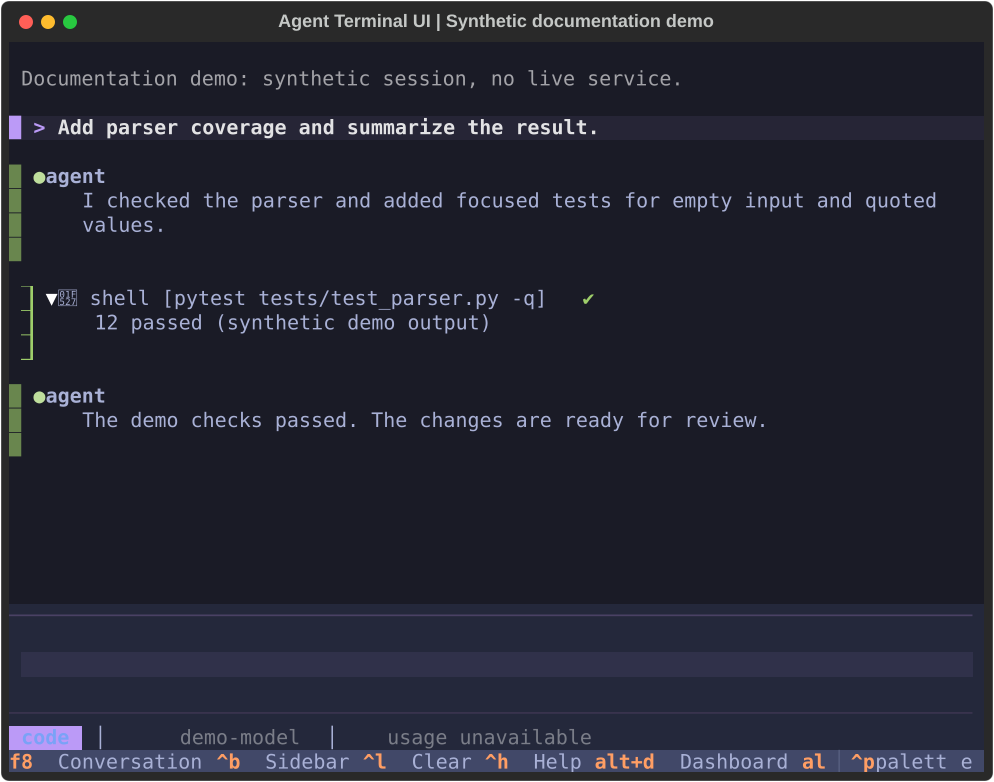
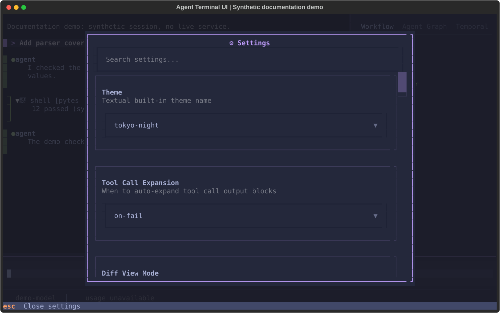

# Documentation screenshots

These images capture the production Python Textual app with synthetic demo data.
They are not live-service receipts or screenshots of the Rust native terminal.
The capture uses the real conversation, workflow and settings widgets. It needs
no gateway, credentials or browser. Personal settings and workspace discovery are
isolated. No prompt is submitted and no tool command runs.

## Refresh

From the repository root, use the committed dependency lock:

```bash
uv run --frozen python -m scripts.capture_screenshots
uv run --frozen python -m scripts.capture_screenshots --check
```

The first command updates these stable paths. The second fails if an image is
missing or stale, without writing files. Review the SVGs in a browser before
committing them. Refresh images when their UI, fixture content or dependencies
change. Do not edit SVG markup to make a changed interface look unchanged.

- `docs/assets/screenshots/chat-wide.svg`: 120 columns by 36 rows.
- `docs/assets/screenshots/chat-compact.svg`: 80 columns by 30 rows, sidebar closed.
- `docs/assets/screenshots/settings-wide.svg`: 120 columns by 36 rows.

The theme is `tokyo-night`; animations and focus cursors are disabled. Textual
exports the actual render to SVG. Font rendering can vary between SVG viewers.
Use `--output /tmp/tui-screenshots` for an untracked preview. Existing files outside
the three managed names remain untouched. These assets need no image converter.

## Gallery

### Chat, wide


### Chat, compact



### Settings



## Validation

```bash
uv run --frozen --extra test pytest tests/test_documentation_screenshots.py -q
```

Tests cover repeatable rendering, private-state isolation and read-only freshness
checks. The documentation screenshot workflow checks committed assets and uploads
a fresh capture for review. It does not commit images or write to the main branch.
