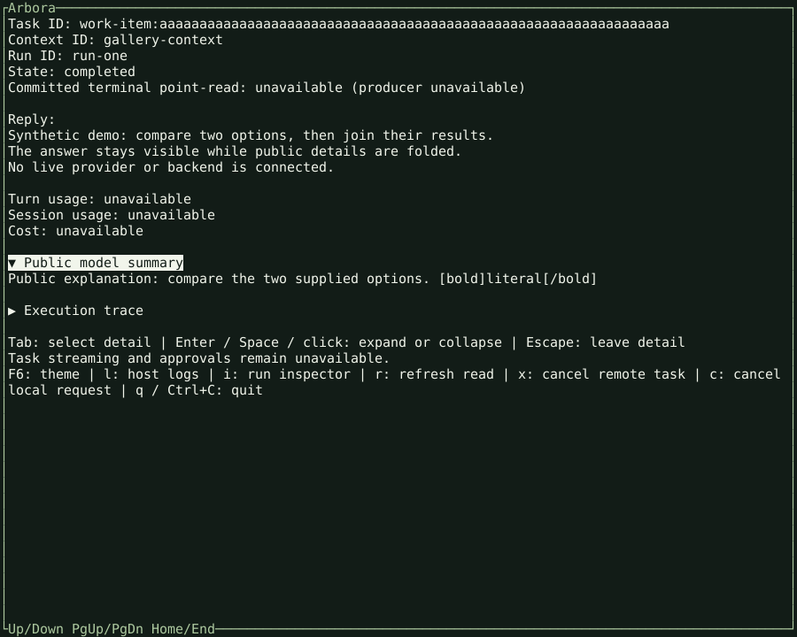
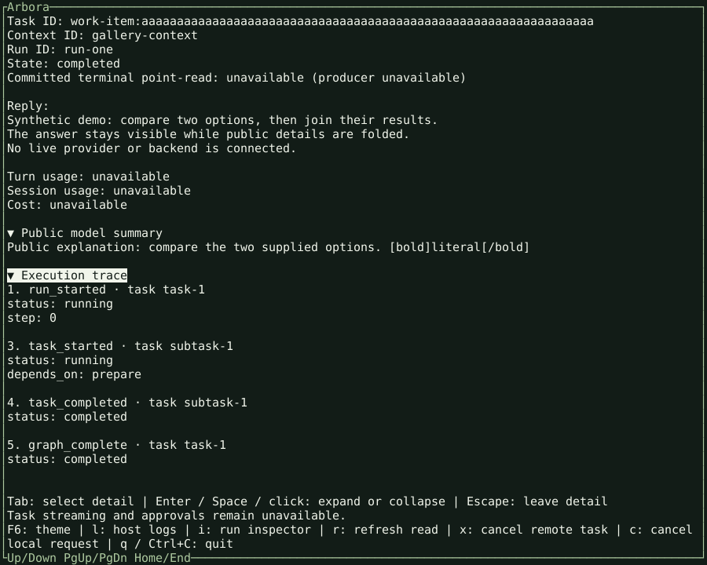
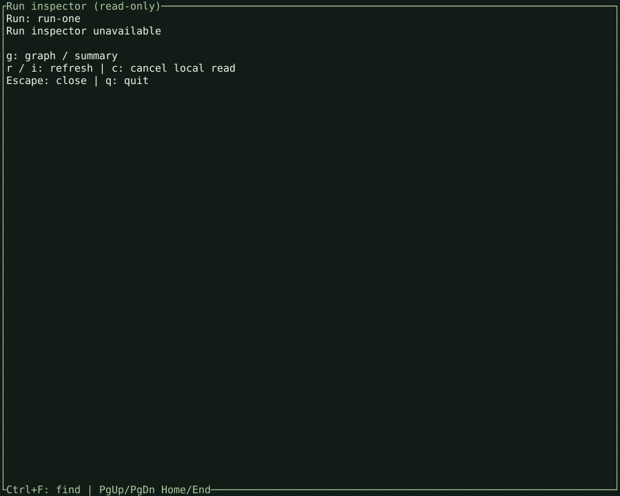
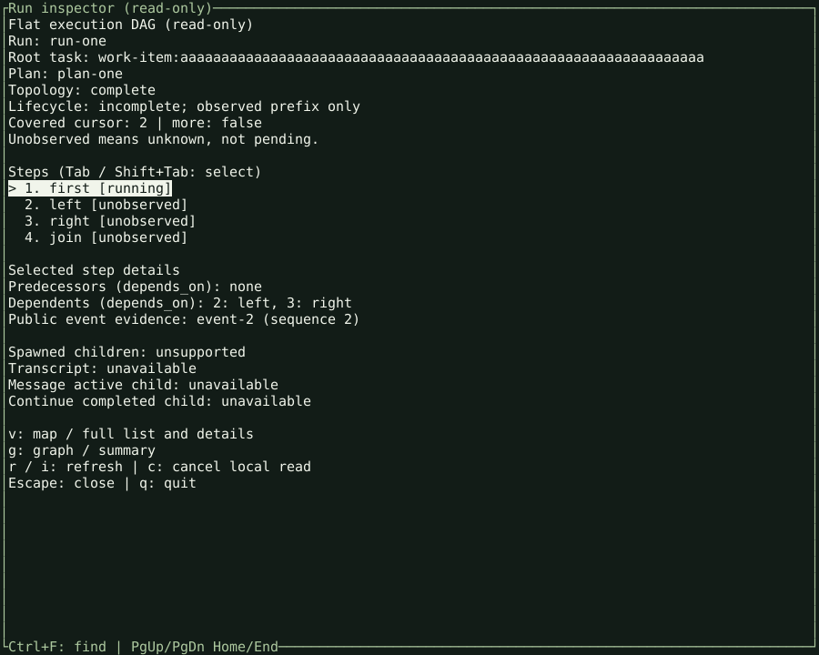
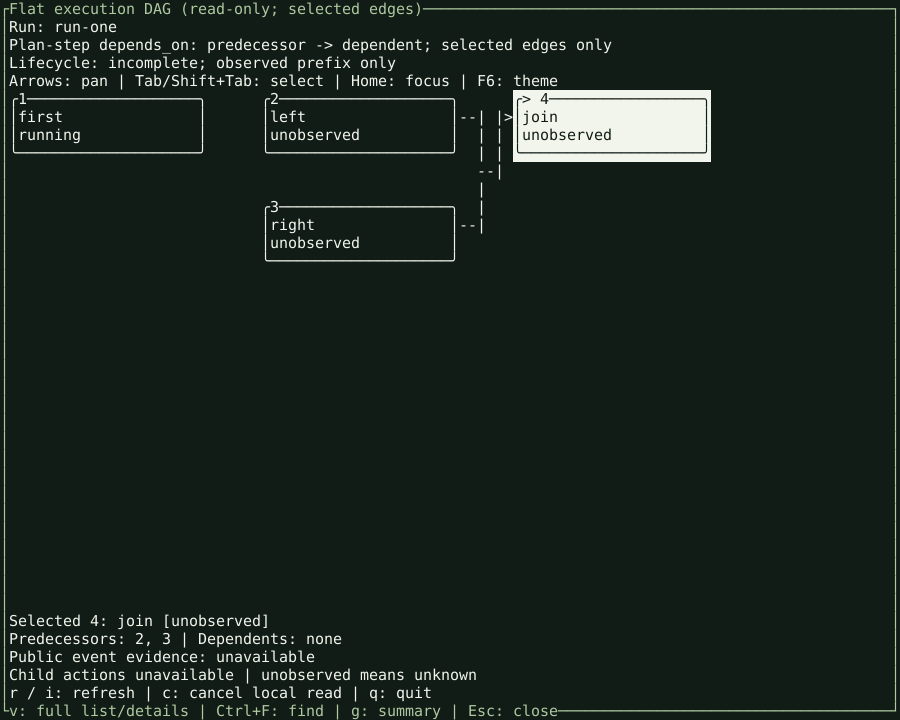

# Native terminal gallery

These six captures come from the compiled Rust/Ratatui `tuig` executable.
The Canopy theme is shown at 100 columns by 40 rows. Each SVG preserves the
terminal cells captured through a real pseudo-terminal (PTY), including colors
and selection. These are generated terminal renders, not desktop screenshots.

**All data is synthetic.** A loopback fixture supplies public Arbora contract
responses. No live backend, provider, credentials, or user data is involved.
The images demonstrate native display and navigation, not production execution.

## Answer and folded details

The answer stays visible while public model summary and execution trace sections
are folded. Task observation does not resume a conversation.


## Public model summary

Tab and Enter expand the public summary. This is public explanation supplied by
the fixture, not private model reasoning. Markup-like text remains literal.



## Execution trace

Both detail sections can remain open. The trace displays public event types and
status from the fixture; it does not imply live streaming support.



## Read-only run inspector

Press `i` to inspect a run. Operations absent from the fixture registry are
explicitly unavailable rather than replaced with invented results.



## Execution graph list

Press `g` in the inspector to open the graph list. Observed lifecycle evidence
and unobserved plan steps remain distinct.



## Spatial dependency map

Press `v` to switch to the spatial view. Shift+Tab selects the join node; the
map identifies its two predecessors. Unobserved nodes are not claimed as running
agents, and a dependency is not a spawned-child relationship.



## Capture provenance and reproduction

The binary came from the Linux x86_64 wheel artifact of
[CI run 40170765761](https://github.com/Knuckles-Team/agent-terminal-ui/actions/runs/40170765761),
artifact `12590225861`. Its source commit is
`a8952ff1036fb67900b5d1f24b629d4c85224ac0`, merged in the native cutover.
It is a CI artifact, not a newly published release. The
[manifest](assets/native/manifest.json) records its SHA-256, fixture hashes,
image hashes, expected screen text, and read-only request paths.

From a developer checkout with the test dependencies installed:

```bash
python scripts/capture_native_gallery.py \
  --binary /absolute/path/to/tuig \
  --source-revision <40-character-source-commit>
TUI_NATIVE_TEST_BINARY=/absolute/path/to/tuig \
  python -m pytest tests/test_native_gallery.py
```

The helper starts a loopback fixture and drives the actual native executable.
It waits for each expected screen and writes the gallery.
It also verifies clean quit and terminal restoration. Python and `pyte` are capture/test tooling only; there is
no Python frontend or browser UI in this capture path. Font rendering can vary
between SVG viewers; glyph positions and terminal colors come from the capture.
The retired Python/Textual gallery remains only in git history.
