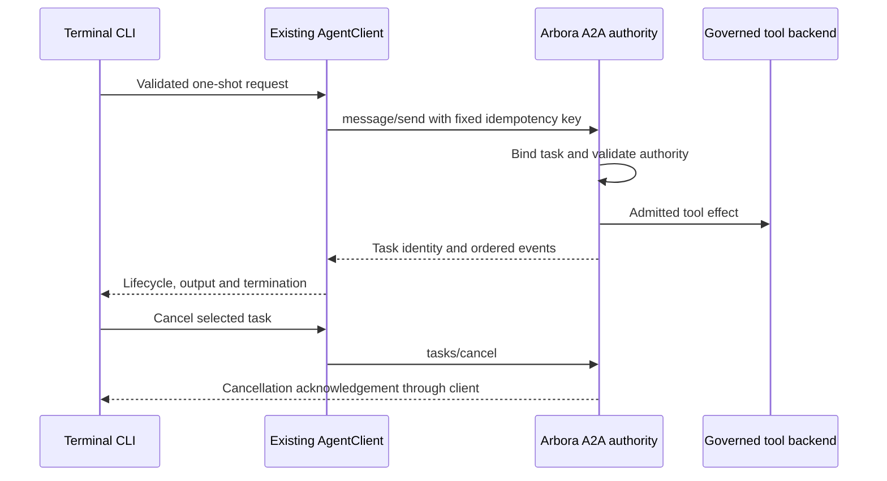

# TUI-RUNTIME design and integration plan

## Existing wiring and architecture

At the current public main revision, `CommandProcessor` in `agent_terminal_ui/commands.py` owns slash-command dispatch and the `/capabilities` and `/run` commands. `AgentClient` in `agent_terminal_ui/client.py` owns HTTP transport, session events and the older `/api/capabilities/*` and `/api/runs/*` routes. `agent_terminal_ui/app.py`, `screens/main.py`, `tui/input_text_area.py`, `tui/capability_palette.py` and `tui/run_inspector.py` are presentation consumers. This is the path to extend; no parallel command router, HTTP client or local Arbora gateway should be created.

At main 5ac5e3fec4d590f167d2c6bd694683dbd8950c26, the TUI-RUNTIME-R001 client implementation is present. Its unit tests do not establish served acceptance. It implements `/op`, `/confirm`, a lazy generated-client import and fail-closed approval behavior. Review and compose its exact changes rather than rebuilding the same transport from scratch. The current main package targets Python `>=3.11,<3.15`; Arbora generated-client compatibility must be handled without raising that base floor silently.

```text
keyboard / slash command
    -> CommandProcessor
    -> AgentClient (one session, caller credential, HTTP/A2A transport)
    -> Arbora versioned operation API or A2A plan confirmation
    -> server authorization, registry and effect gate
    -> typed result/error -> existing conversation and run widgets
```

## Contracts and decisions

| Boundary | Contract to implement or verify |
|---|---|
| Command input | `/op <registered-id> <JSON object>`; JSON is parsed once; a malformed or absent object is refused before any network call. `/confirm <opaque-plan-ref>` never accepts a caller-supplied substitute operation or parameters. |
| Generated operation client | Resolve `schema_for(op)` and `invoke(transport, op, params)` lazily. The installed registry digest must match the server. Missing package data or incompatible runtime yields `CLIENT_UNAVAILABLE`, not a fallback to an untyped endpoint. |
| HTTP operation | Use Arbora's public versioned operation endpoint, caller-scoped authorization header, structured result and stable error envelope. No direct import of arbora server internals or AU knowledge-graph internals. |
| A2A conversation | Reuse the Arbora Agent Card and authenticated JSON-RPC task flow. Keep session/task identity on streaming and resumed turns; network errors must leave the UI responsive. |
| PLAN | Store only the short-lived server binding necessary for display and one confirmation. Bind to exact plan reference, op, input digest, caller/session, registry digest and expiry. The server makes the final authoritative check. Clear after use or failure. |
| Approval | An `input-required` task is a pending request. Signed approval must be bound to the pending call and human authority in Arbora. Until that public contract and served proof are present, refuse `approvals.*` and direct fleet-grant shortcuts. |
| Security | Require TLS and a verified credential for remote Arbora. Do not emit bearer values to logs, widgets, saved sessions, test snapshots or exception strings. Local development endpoint rules must be explicit and bounded to loopback. |

## Compatibility and migration

Keep the TUI's base chat install working at the supported Python floor. The 2026-10-18 support amendment below records its accepted change. Put a generated Arbora operation client behind a compatible optional extra or runtime capability check. Document the precise supported Python range in package metadata and lock. Where legacy capability/run APIs remain, inventory their callers and retire each only after a public replacement is served. The GeniusBot consumer must independently prove the same versioned envelope and identity rules. This repository only supplies its contract expectations.

## Quality and reuse

Use the existing command registry, `AgentClient`, `httpx`, Textual widgets, and Arbora generated models. Keep one transport normalization path and no duplicated request envelope construction. Run the repository's configured Ruff, type and pytest checks. The current repository has no configured CCCC, `jscpd` or Dupehound command or threshold. Before acceptance, either add shared ecosystem invocations with an explicit baseline or record an agreed exception. Do not claim a numerical pass without a configured tool. Apply KISS through a single client and one-use confirmation state. No unrelated `/docs` edit is required. Update README/configuration only where command or credential setup changes, and update AGENTS/constitution only if the contract itself changes.

## Structure parity with agent-webui (2026-10-11)

The operator requires agent-terminal-ui to use the same structure as agent-webui. The table compares structure only.

| Element | agent-webui | agent-terminal-ui | Action |
|---|---|---|---|
| Specs | 6 area specs | 1 spec (`terminal-runtime`) | Decisions below; no new directory |
| Workflows | `advisory.yml`, `release.yml` | `pages.yml`, `pipeline.yml` | Differs in names; add release caller (R007) |
| Pages caller | `pages_pipeline.yml@main`, `spec_dashboard_enabled: true` | same | Same |
| Python pipeline caller | none seen | `python_pipeline.yml@main` | Keep |
| Pre-commit | `.config`/root config, 50+ hook ids incl. spec-standard, ste-staged, public-surface | root config, 26 ids | Add spec hooks (R004) |
| `pyproject` hook sections | `public_surface`, `ste` | none | Add (R006) |
| Packaged development skill | present | missing | Add (R003) |
| Docs | start, status, deployment, design-system, apps, atlas, others | agent_view, configuration, session pages | Add four pages (R005) |
| `mkdocs.yml` | present | present | Same |
| AGENTS.md | Commands, Quality gates, Branching, Documentation, Specs | Working discipline, worktrees, Specs | Add headings (R009) |

Area decisions, from the terminal code:

| webui area | Terminal client has it? | Decision |
|---|---|---|
| Design system | Yes: `app.py` selects a Textual theme (`tokyo-night`) | New rollup `TUI-RUNTIME-R008` in the existing spec |
| Decision evidence | Partly: `app.py` approval decisions, covered by `R001.5` | No new row |
| Finance asset manager | No: `git grep` for finance and asset finds nothing | No spec |
| API consumer | Yes: `client.py` Arbora boundary, owned by `R001` and `R002` | No new row |
| App surfaces | Yes: `screens/`, owned by `R001.7` | No new row |
| Identity and access | Yes: bearer caller identity, owned by `R001.2` | No new row |

## Run harness surface (TUI-RUNTIME-R010)

### Existing source and planned wiring

`CommandProcessor.cmd_run` (`agent_terminal_ui/commands.py:244`) → `open_run_inspector` (`app.py:869`) → `RunInspectorScreen._poll_once` (`tui/run_inspector.py:399`) → `AgentClient.get_run_summary` (`client.py:804`).

Current source ends at `GET /api/runs/{id}`. It does not invoke `runs.get` or `runs.metrics`.
The implementation must migrate this existing path only when the registered replacement has served proof.

The client must use the versioned Arbora operation transport and its generated envelope.
It must not add another HTTP stack or call the engine directly.

### Model and wire-to-view mapping

[Arbora run reads](https://github.com/Knuckles-Team/arbora/tree/main/specs/hosted-api-operations) own the served projection.
`ARBORA-OPS-R021.4.5` serves per-run fields; `.3` and `.4` define aggregate models and operations.
`ARBORA-OPS-R021.4.6` supplies registration and generated artifacts.

| Arbora wire field | View label and behavior |
|---|---|
| `termination_reason` | Distinct final answer, context overflow, stuck, step budget and error labels |
| `peak_context_tokens`, `context_budget_tokens` | Peak context tokens against run budget; never current occupancy |
| `cost_usd` | Per-run USD cost |
| `harness_config_ref`, `harness_config` | Applied decision reference and available configuration fields |
| `current_plan` | Available snapshot items, revision and observation time; read-only |
| `runs.metrics` result `cost_per_solved_task_usd` | Aggregate cost per solved task, with query grouping and abstention |

The client must not accept RDF camelCase fields as alternate wire names.
The client must preserve null availability and measured zero as different values.
The engine defines solved tasks and computes aggregates under `EG-ORCH-VOCAB-R010`.
Zero-solved cost abstention must display unavailable, never zero or per-run cost.
Pair-level rates and configuration-level costs must retain separate group labels.

### Current-plan prerequisite and refusals

`AU-HARNESS-R014.1` through `.5` own mutable `PlanState` outside stored message history.
Those rows supply no public snapshot read contract today.
`ARBORA-OPS-R021.4.5` defines the required cross-boundary snapshot and blocks availability until the AU producer exists.
The client must not derive a plan from messages, reconstruct state, or add a plan writer.
An available empty plan must differ from unavailable state.
Run switches, denied refreshes and expired snapshots must clear protected values from the previous display.
A missing plan must not suppress other independently available trace fields.
Unknown terminal reasons must display unavailable; the client must never infer success from a final answer alone.

### Evidence and implementation order

Implement the Arbora producer before the consumer wiring, then field rendering and served acceptance.
The six existing children retain their served acceptance requirements.
R010.7 adds only the native state boundary.
The tests in test-spec.md are planned acceptance paths, not proof of implementation.
Each row requires its own positive and negative served case through the production UI path above.

### Amendments

- 2026-10-11, rows `TUI-RUNTIME-R003` to `TUI-RUNTIME-R009`: the operator required agent-terminal-ui to match agent-webui structure. The old state had no structure rows. The new state adds seven rollups. Evidence: the comparison table above.

<!-- spec-definition-patch:r002-consumer-plan -->
## TUI-RUNTIME-R002 consumer boundary

The Arbora owner must publish contracts R009.2 through R009.6 and R010.7. Those contracts bind a versioned HostLaunchReceipt, interface mode, workspace and opaque tenant-authorized log reference. Arbora authorizes each read and reconnect. It supplies record order and rotation gaps. These IDs are producer prerequisites. They do not claim existing runtime exports. The terminal never grants authority or reads a local log path. R010.7 places web_logs in HostLaunchRequest, but the current HostLaunchReceipt v1 contract omits it. Arbora must bind the effective boolean into an authenticated receipt or handoff, scoped to host, workspace, tenant and principal. Until Arbora supplies that field, TUI log reads stay disabled. The required host redacted sink remains enabled. This is a producer prerequisite, not a claim of an existing export.

Dependency order:
1. Keep the original R002 chat transport acceptance in child .1.
2. Consume the receipt. Validate version, readiness, endpoint, session, workspace, host, mode, tenant, expiry and bound web_logs preference.
3. Define the adapter signature: `agent_terminal_ui.app.run_host_terminal(receipt: HostLaunchReceipt, *, client: AgentClient, log_reader: HostLogReader | None) -> None`.
4. Define HostLogReader in agent_terminal_ui.client. Its asynchronous method is `read(log_ref: str, *, cursor: str | None, limit: int) -> HostLogBatch`.
5. Subscribe in terminal and both modes only when the bound web_logs preference is true. A false or absent preference and every web-mode case make zero TUI reads; chat continues. Keep the required host sink enabled. Reuse CommandProcessor.cmd_logs, MainScreen.action_toggle_logs and RichLog.
6. Bound reads, queued bytes, lines, timeouts and cancellation as requirements.md states. On rotation, expose a tenant-local gap. On denial, clear protected state. Never stop Arbora resources.
7. Exercise the full served path on a real host, client and TUI. Use the fixed seed and two tenants after producer contracts are available.

The TUI defines consumer interfaces here. It does not claim existing exports. Extend AgentClient, the application, CommandProcessor.cmd_logs and MainScreen.action_toggle_logs. Do not add another router, transport, local gateway or file reader. This slice leaves the TUI-RUNTIME-R010 inspector obligations intact.

AU:116 SHA-256 08a22602bd677e4fc39260d058503fa73a2216ad40bbe817c17d3bef256722ef. Map the remaining TUI obligation to R002.2, .3, .5 and .6.
AU:117 SHA-256 fddbc1b35588be4427396a7aa827414d9d7bba01a8837f905a8b1c9b1eac4694. Map its remaining mode and unified-view obligation to R002.2 through .6, especially .4. R002.1 preserves the parent acceptance. These are definition mappings only.
<!-- /spec-definition-patch -->

## Amendments

### 2026-10-13: Rust thin-client migration (R002, R001, R008, R010)

Decision: use Rust with Ratatui for native terminal rendering and Tokio for asynchronous execution. Keep Arbora as
runtime, policy, authentication, task and operation authority. EG owns graph
storage and reasoning. The terminal must not embed a graph replica, planner,
model runtime, tool executor or second MCP authority. Existing Python stays
available until a release candidate passes the same served journeys.

Source baseline: TUI `5ac5e3fec4d590f167d2c6bd694683dbd8950c26` uses A2A
chat plus REST, not ACP. The reviewed Arbora `660412bf` dispatcher lacks served
`message/stream` and refuses `tasks/resubscribe` and `arbora.plan/confirm`.
These are producer prerequisites, not working features. Client mocks and
Agent Card claims cannot close them. Record producer head and served receipts
before enabling each feature. No downgrade to an untyped or local effect path.

```text
terminal input -> command intent -> bounded asynchronous transport queue
    -> authenticated Arbora A2A / versioned operations
    -> bounded normalized events -> view-state reducer -> terminal frame
Arbora -> runtime / policy -> EG graph and reasoning
```

Use one transport adapter per frontend process. Port the existing AgentClient
normalization and CommandProcessor semantics; share public wire fixtures with
Python instead of building a second protocol. The renderer draws presentation state
only. The asynchronous runtime owns transport, cancellation, deadlines and bounded queues. UI
input and resize must remain responsive while a request or reconnect is pending.
The operator selected Ratatui. Acceptance measures rendering behavior, not the library brand.
Preserve keyboard navigation, dynamic theme tokens, no-color and reduced-motion
behavior, selection and scroll position. Approval uses a distinct modal.

Keep server task ID, context ID and run ID as separate opaque values. A local
view ID is never a substitute. Store server correlation explicitly; do not infer
run identity from a task string. Reconnect retains these bindings. Duplicate
events are idempotent by stream generation and sequence. A gap or cursor expiry
invalidates the affected view and requires an authorized snapshot plus a new
cursor. Never replay a submission, confirmation or cancellation as a new task.
Unknown submission outcome requires reconciliation or explicit user action.

Cancellation requests the existing server task cancellation and waits for its
acknowledged state. A local canceled future is not proof of remote cancellation.
A disconnect displays unknown/pending state, retains identity and offers recovery.
Approval fails closed during disconnect, missing capability or missing signed
pending-call identity. PLAN confirmation retains exact reference, subject,
parameters digest, registry digest and expiry; only Arbora authorizes effects.
Revocation clears protected views and pending plans before further rendering.

Start with direct remote service access. A local UDS or Windows named-pipe broker
is optional only after the benchmark below proves a net benefit. It may cache
only authorized views scoped by principal, tenant, workspace, endpoint and
policy epoch. Peer credentials and restrictive socket/pipe ACLs are required;
a local connection never grants Arbora authority. No public listener or shared
cross-principal cache. Bound bytes and events per subscriber. Disconnect slow subscribers with an
explicit gap. Recover through retained replay or an authorized resnapshot. Revocation, logout and expiry invalidate cached data and cursors.
The broker must not interpret graph state or call MCP tools independently.

### Spec-delivery record

This amendment defines the migration under existing R002, preserves all R001
approval and R010 run-observation obligations, and extends R008 presentation
acceptance. Definitions are proposed for review; no Rust runtime is delivered
or verified. Existing generated VERIFIED labels describe source/test bindings,
not served deployment proof. The missing producer methods remain blockers.
Keep pipeline callers and shared hooks at `@main` / `rev: main`. Parent reviews
and merges the non-draft PR. No version or dependency change is needed here.

### OpenCode coexistence and cutover

The goal is a native terminal connected directly to Arbora that replaces
OpenCode. First establish working OpenCode access to the terminal development
skill and Arbora. Keep OpenCode installed and usable throughout implementation
and validation. A Rust build or mock test cannot authorize its removal.

Before cutover, demonstrate skill discovery and invocation in both clients.
Prove parallel Arbora agents, streaming, cancellation, approval refusal and session recovery. Arbora owns parallel task admission and
lifecycle; the TUI only presents and controls authorized tasks. Preserve each
agent's task/context/run bindings. Do not spawn a second local orchestrator.
Record exact client and producer heads, served receipts and parity gaps. Require
operator approval after parity evidence and the performance gates pass. Keep a
working OpenCode rollback path until the operator accepts the replacement.

Canonical skill: `agent_terminal_ui/skills/agent-terminal-ui-development/SKILL.md`.
OpenCode provisioning must expose that maintained file, rather than a forked
copy of its instructions. Provisioning itself is not delivered by this spec.

### Native discovery entry point (R002.7)

The separate native/agent-terminal-ui executable reads the existing AGENT_URL
and AGENT_BEARER_TOKEN settings. Its single HTTP client fetches
/.well-known/agent-card.json. Ratatui renders discovery state while Tokio handles
the request and terminal input. A response name does not prove task capabilities.
The c key cancels local discovery; r retries after completion; q exits and
restores the terminal. There is no task, approval or engine execution path.

The Python executable and OpenCode remain available. Native compilation uses a coordinated validation slot. Source and format checks
alone do not establish delivery or served Arbora acceptance.

The initial Linux check passed six native tests with real loopback HTTP fixtures.
The cold two-job build took 38 seconds. Formatting and Clippy passed with warnings
denied. A pseudo-terminal smoke passed discovery, refusal/retry, cancellation and terminal restoration.
This evidence covers discovery only. No configured live Arbora endpoint
was available, and no served streaming or approval acceptance is claimed.

### 2026-10-13: Native task correlation model (R002.1.1)

Reuse AgentClient's task, status-update and artifact-update wire fields. Add a
native typed model with an immutable task/context/run binding and explicit
validation before returning an event. Share a redacted JSON fixture with the
Python normalizer tests. This model has no network or retry behavior. Native
submission and streaming still require the missing served producer proof.

### 2026-10-13: Unary snapshot delivery and remaining producer gaps

Rechecked TUI main 4239e3b and Arbora main 331044ed. The authenticated
Arbora A2A facade serves tasks/get and tasks/cancel. The separate agent-host
endpoint supports message/send only. An Agent Card alone does not prove task
read capability. The native task view uses only the unary tasks/get method.

Arbora still lacks message/stream. Its tasks/resubscribe handler returns an
explicit refusal. Host receipts, bound web_logs and log-reader exports remain
specifications. R002.1.3 and R002.2 through R002.6 stay pending. OpenCode and
Python remain available. No cutover, performance or complete migration claim
is made by the model and snapshot children.

Native HTTP tests cover the request, credential, response bounds and refusals.
The executable was also checked through the real Arbora HTTP handlers and
A2AService with upstream test authority and authentication fixtures. That
check covers the handler boundary, not production identity, tenant isolation,
TLS or WorkItem authority. It requires no native EG build.

### 2026-10-14: Native unary submission increment (R002.1.3.1)

Arbora main 0120e1f serves ordinary text tasks through message/send.
It uses request-bound authentication, WorkItem admission and the existing AU dispatch
queue. Add one native --prompt submission. Retain the acknowledged task
binding in the existing refresh and cancellation view. Generate the request
identity once. Do not retry an effect or replay it on refresh. An interrupted
submission has an unknown outcome. Reject a prompt combined with AGENT_TASK_ID.

Verify the native executable against the actual Arbora request handler,
WorkItem submission and AU enqueue functions. Control the final storage and
queue boundaries. Check the authenticated carrier and zero admission for
denied requests. This proves the submission adapter, not durable engine or
worker completion. Preserve production-profile refusal when its configured
dispatch authority is absent. Streaming, session recovery, the six original
requirements and OpenCode cutover remain pending.

R002.1.3 now rolls up this bounded adapter in R002.1.3.1 and the preserved
original served integration acceptance in R002.1.3.2. Retain every parent criterion. A fixture-only positive response cannot close
the parent.

### 2026-10-13: Original cancellation criterion

The nearest available R002.1 producer is tasks/cancel. Arbora main 331044ed
already routes this method to WorkItemA2AAuthority. The native consumer
requires explicit confirmation and a matching canceled response. An interrupted
request has an unknown outcome until a read reconciles it. The client never retries an effect automatically.

Missing producer contracts remain with Arbora. ARBORA-A2A-R001 and
ARBORA-A2A-R010 own durable streaming and resubscribe. Their spec names the
AU-CONTROL-001 event port; a current AU owner row was not found.
ARBORA-HOST-R009.2 through ARBORA-HOST-R009.6 and ARBORA-HOST-R010.7 own the host/log journey.
ARBORA-A2A-R005.2 and ARBORA-A2A-R006.2 retain approval and verified-caller prerequisites.
Coordinate those changes with the parent before touching active producer work.

The native suite passed 32 tests, including the configured ten-second timeout.
Formatting and strict Clippy checks passed. Six pseudo-terminal cases passed
through Arbora handlers, A2AService, WorkItemA2AAuthority and the AU cancellation adapter.
They cover confirmation, dismissal, refusal, response loss after commit, local interruption and read reconciliation.
Each case checked wire counts and terminal restoration. The fixture uses a
synthetic session and scripted storage. Native EG storage, worker interruption,
production authentication and TLS remain unqualified. The original six migration
rows remain pending. Keep OpenCode until served parity and cutover acceptance pass.

## One-shot tool-task consumer

Component: Terminal task view
Depends-on: TUI-RUNTIME-R001.2, TUI-RUNTIME-R001.3, TUI-RUNTIME-R001.5, [Arbora A2A](https://github.com/Knuckles-Team/arbora/blob/331044ed7daec51a3633e0a7ea712293b2063bf3/specs/a2a/spec.md)

Code: ../../agent_terminal_ui/terminal_ui.py:10

Code: ../../agent_terminal_ui/client.py:520

Code: ../../agent_terminal_ui/client.py:587

Code: ../../agent_terminal_ui/client.py:597

Code: ../../agent_terminal_ui/headless.py:163

Existing code: terminal_ui dispatches CLI options; AgentClient owns task transport and the headless path owns streamed rendering.
Reachable today: no exact one-shot tool-task command or matching-scope preapproval projection is present.
The native model and read-only snapshot slices remain separate from the required served one-shot transport.

The CLI must add --one-shot as one explicit mode, exclusive with --prompt and --headless.
Read exactly one UTF-8 JSON object from standard input without echoing or logging its bytes.
Never accept request parameters or preapproval_ref through command arguments.
The input object must contain operation_id, object parameters and idempotency_key; preapproval_ref is optional.
Reject unknown fields, duplicate JSON keys, malformed objects and inputs above 64 KiB before any network call.
The client must validate the operation and schema through the existing generated registry under R001.
The client must create one request binding before submission and retain it across reconnect.
AgentClient must add a typed message/send method beside its existing text-only stream method.
The terminal must send the typed payload through that method, never reinterpret it as an unstructured prompt.

Producer dependency: Arbora must publish the exact message/send tool-task payload schema and preapproval projection under ARBORA-A2A-R005 and ARBORA-A2A-R006.
The existing public A2A contract defines task methods and pending-call approval; it does not define that tool-task payload.
The initial scope receipt must bind caller, tenant, workspace, operation, parameter digest, policy revision, registry digest and expiry.
After admission, Arbora must bind that receipt to the task and exact pending call before attesting prompt suppression.
The final pending-call binding must come from the server after task admission, never from caller-supplied identity fields.
The one-shot request authorizes one connector operation invocation, without expanding its granted scope.
Arbora must consume the final pending-call grant atomically and dispatch that operation at most once.
Progress and task events do not authorize additional connector invocations.
A valid preapproval may suppress presentation of a prompt; it must not bypass server admission or console step-up.
The complete ARBORA-A2A-R005.2 signed chain and ARBORA-A2A-R006.2 caller bridge remain prerequisites.
Missing binding or served authority proof must keep prompt bypass disabled.
This consumer definition must not invent a producer export or claim the original cross-owner obligation is complete.

Observation must use tasks/get and tasks/resubscribe with the original opaque task identity.
Use the existing bounded transport queue and renderer, preserving output order and explicit gaps.
An explicit cancel must call tasks/cancel and wait for acknowledgement before displaying cancelled.
Detach must stop only the owned observer and print its opaque task identifier without credentials.
A later --observe-task TASK_ID invocation must authenticate and use tasks/get followed by tasks/resubscribe.
That mode must never submit an operation, accept preapproval or invoke confirmation.
It must refuse --one-shot, --prompt and --headless combinations.
A denied or unknown task must reveal no output.
Terminal loss must not imply remote cancellation or successful completion.
The terminal must clear protected output when authorization expires or the caller changes.



Decision: reuse the existing task transport and renderer; reject local task execution and unconditional approval flags.
Implement the producer binding first, then the typed input, observation, refusal, evidence and served proof children.
The planned tests must cover both frontend implementations before native cutover, using identical task and scope fixtures.

## TUI-RUNTIME-R001.8

`TUI-RUNTIME-R001.8`: Extend command/client contract for one-shot background tool-task submission with Arbora preapproval binding gate.

## Coding session (TUI-RUNTIME-R011)

Extended or new: new rollup; no existing rollup owns the coding session (search terms: coding, workspace root, diff, resume).

Data flow, in order:
- `terminal_ui` (`agent_terminal_ui/terminal_ui.py:10`) opens the session with the workspace root.
- `AgentClient._rpc_stream` (`agent_terminal_ui/client.py:353`) delivers an agent request.
- The new `CodingSessionView` handler (`agent_terminal_ui/coding_session.py`) receives it.
- `WorkspacePolicy.check_operation` (`agent_terminal_ui/workspace_policy.py:177`) checks containment.
- The view displays the diff or command, and the person approves.
- The host performs the local read, write or process, and the result returns to the gateway.

Existing code:
- `agent_terminal_ui/client.py:338` and `:353`: JSON-RPC over HTTP for agent tasks only; no `fs/` or `terminal/` method.
- `agent_terminal_ui/app.py:7`: docstring only.
- `agent_terminal_ui/app.py:572` and `agent_terminal_ui/tui/tool_approval_screen.py:35`: tool approval modal.
- `agent_terminal_ui/screens/permissions.py:164`: PermissionsScreen, exported at `agent_terminal_ui/screens/__init__.py:13`, never pushed.
- `agent_terminal_ui/danger.py:229`: command danger level.
- `agent_terminal_ui/workspace_policy.py:63`, `:177`, `:214`, trust mode `:104`, and `agent_terminal_ui/settings.py:197`.
- `agent_terminal_ui/workspace_snapshots.py:50`, `:158`, `:229`, `:357`, and `agent_terminal_ui/settings.py:176`.
- `agent_terminal_ui/session_manager.py:161` and `:303`.
- `agent_terminal_ui/app.py:695`: resume of a stored chat, reached from `agent_terminal_ui/commands.py:260`.
- `agent_terminal_ui/headless.py:163` and `opencode.json:1`.

Reachable today: no for the coding session. Only `ToolApprovalScreen` (`app.py:608`) and chat resume (`commands.py:260`) are reached by a production caller, and neither serves a file or terminal request. `WorkspacePolicy`, `WorkspaceSnapshotManager`, `SessionManager` and `PermissionsScreen` have no production caller; the grep `git grep -n -E "WorkspacePolicy\(|WorkspaceSnapshotManager\(|SessionManager\(|PermissionsScreen\("` finds none outside their own modules. The search for `fs/`, `terminal/` and `request_permission` finds no handler.

Types and fields: `CodingSessionView(root, capabilities, session_id, pending)`; capability set closed to six methods; refusal enum of five reasons.

Attach point and caller: the handler attaches to the stream loop at `agent_terminal_ui/app.py:484`; its production caller is the running `terminal_ui` application.

Failure behavior: a gateway loss keeps the pending request, answers nothing, and resumes without granting.

Decision: the client performs file and terminal actions on the host as protocol client capabilities. `ARBORA-ACP` owns admission and permission rules. `AU-CONTROL` exposes the tools. Rejected: a cluster service that mounts or syncs the host checkout. It copies data and needs host credentials on the cluster.

Cross-repository rows: `ARBORA-ACP` contract `CodingSessionAdmission`; `AU-CONTROL` contract `ClientCapabilityToolset`; `EG-DECISION-ENGINE` `HarnessConfig` supplies the tool selection. This repository states only `CodingSessionView`.

References: none; no paper is cited.

### 2026-10-16: Native run inspector boundary (R010.7)

`native/agent-terminal-ui/src/run_inspector.rs` owns normalized display state.
The Rust attachment point replaces the Python-named view for this slice only.
It preserves unavailable values, measured zero, recorded configuration and
terminal reasons. Run switches and failed reads clear protected display values.
An injected plan validator must use the future AU revision and expiry contract.
No validator means no plan items. The view checks run identity and clears expired
plans before rendering. It never orders opaque revisions or invents a wire schema.

`native/agent-terminal-ui/tests/run_inspector.rs` exercises this boundary through
Ratatui. These are focused consumer tests, not served acceptance. R010.1 and
R010.6 remain open: Arbora registration, generated projections, AU snapshot
exports and production transport attachment are prerequisites. The presentation
lane must attach the module to its view. The transport lane must supply authorized
projections and the producer-defined validator. No backend route or local read is
added. All six existing requirement rows and their served tests remain required.

The library exports `run_inspector` through its public API. Focused tests import
that API, so normal crate compilation includes the module. Production view/key
attachment and authorized producer adapters remain deferred.

Boundary tests bind only to `TUI-RUNTIME-R010.7`. The earlier served requirements
and their checkboxes stay pending. This child requires no production activation.
### 2026-10-16: Native approval state boundary (R011.13)

`native/agent-terminal-ui/src/coding_approval.rs` is the Rust presentation
attachment for this slice of `CodingSessionView`. It holds exact pending request content and previews the full diff or command.
It records an explicit choice bound to that preview. Changed, foreign and completed request IDs cannot reuse a choice.
Gateway loss retains unanswered requests. Reattachment does not approve them.
Records contain request/session identity, method, resolved path or adapter-supplied
command digest, choice and actor. Preview bodies never enter records.

The module has no file, process, persistence or transport effects. Its choice is
not an Arbora permission grant. The future admitted-session adapter must verify
scope, capabilities, resolved paths, content/digest bindings and permissions before
calling it. It must recheck these before any effect. Diff inputs are authorized old/new text;
command digest comes from that adapter. No digest algorithm or wire field is added.

`native/agent-terminal-ui/tests/coding_approval.rs` covers the state boundary and
Ratatui preview. The native application and client must attach it after
`CodingSessionAdmission` and `ClientCapabilityToolset` are implemented. Existing
Python attachment references remain historical and are replaced by Rust only for
this view slice. Durable resume, host effects, containment and served entry-point
proof remain open. The existing twelve rows are not promoted by these unit tests.

The library exports `coding_approval` through its public API. Focused tests import
that API, so normal crate compilation includes the module. Production view/key
attachment and authorized producer adapters remain deferred.

Boundary tests bind only to `TUI-RUNTIME-R011.13`. The earlier served requirements
and their checkboxes stay pending. This child requires no production activation.

### 2026-10-16: Unambiguous approval previews

R011.13 escapes literal backslashes as well as control characters. Command,
path and file previews must distinguish a control character from typed escape
text. The change grants no authority and performs no host action.
### 2026-10-16: Bounded native read recovery (R002.1.3.2)

Implement only unary tasks/get recovery in the existing native client and refresh
path. Use at most three reads, 100 ms then 200 ms backoff, and a 12-second
overall deadline. Retry transport loss, interrupted bodies and HTTP 502, 503 or
504. Refusals, malformed responses and correlation mismatches stop immediately.
Keep the original opaque task/context/run binding; omitted run metadata cannot
replace it or acquire a later run. Hide the protected snapshot on failure and
disable cancellation until a matching authorized read succeeds. Recovery can
never submit, cancel, confirm or resubscribe.

Producer source refreshed at Arbora 16d01372b70634850d056a7b667e78270c0c3edd:
arbora/a2a/application.py serves tasks/get and returns HTTP 401/403 for
authority denial. Task absence returns 404. tasks/resubscribe still refuses;
message/stream is absent. Use these existing fields and refusal boundaries.
Local HTTP fixtures prove bounded read attempts, exact correlation, denial,
refresh and zero effect replay. They do not prove production authentication,
streaming, cursor replay or session continuity. R002.1.3.2 remains pending,
as do its full served acceptance and cutover.
## Amendments

### 2026-10-16: R008.2 native presentation increments

Add Tokyo Night, Nord, Gruvbox and Textual Light foreground/background tokens
from the existing Textual baseline. Keep the Tokyo Night fallback and nonempty
NO_COLOR terminal colors. Check a 4.5:1 foreground contrast floor. The renderer
remains static, including reduced-motion use; no animation is introduced.

Add a bounded wrapped viewport with PageUp, PageDown, Home and End. Keep the
requested row through refresh and resize; clamp the displayed row to current
content. Check Unicode wrapping, short viewports and position retention with
terminal buffers. These increments do not close full R008.2 parity, runtime
theme switching, selection, native cutover or performance qualification.

### 2026-10-16: Keep cancellation confirmation visible

R008.2.2 keeps the cancellation question outside the scroll viewport.
Navigation cannot hide it. A terminal below 34 columns or five rows must
resize before confirmation is allowed; dismiss and quit remain available.
### 2026-10-16: R007 release caller regression

Add the prescribed YAML-level test for the shared release workflow at `main`.
Keep the current tag and manual triggers. A commit pin must fail this test.
This adds regression evidence only; it does not qualify a release.

### 2026-10-16: R007 regression environment

The shared CI job must install the declared test extra before it runs the
release regression. Use its setup-command input with frozen dependencies.
The shared test step then retains that environment with --no-sync.

### Generated Arbora client acceptance

R001.6 keeps Python 3.11 base chat support. Its optional operation client requires
Python 3.12 or later and a compatible generated Arbora wheel. CI installs the
client from an immutable Arbora revision without server dependencies. The job
runs operation and refusal tests. Deterministic UQL examples
use the provider's `text` and `params` fields. This proves the wheel consumer
boundary, not a running Arbora server or native query delivery.

### R010.8 native run reads

The native inspector adapter uses the authenticated registry and registered `runs.get` route.
It checks the response digest before projecting fields. Plan deadlines use validated UTC expiry and a monotonic clock.
The coordinator owns main-loop attachment. AU execution admission and Arbora trace-reader composition remain required for served acceptance.

### R010.9 native inspector loop attachment

The native loop opens the inspector with `i` from the validated task run binding.
The inspector owns one asynchronous read. `r` refreshes, `c` aborts locally, and Escape closes it.
Task read failure and run changes clear protected values and abort pending inspector reads.
Quit also aborts the read. A periodic redraw expires plans while input is idle.
Local interaction tests cover this attachment. R010.6 still requires served acceptance through the published producer contracts.

### 2026-10-17: Bounded task stream decoder

R002.1.3.2.2.1 adds a local SSE consumer in `task_stream.rs`.
It accepts a request identity and an existing task binding.
Each event must pass JSON-RPC and correlation checks before its cursor becomes visible.
Cursors remain opaque. The decoder assigns no sequence or generation meaning.
Line and event limits bound retained input. Invalid input stops that decoder.
Tests cover fragmented UTF-8, line endings, multiline data, limits and mismatched identities.
This component does not establish producer streaming, HTTP wiring or served recovery acceptance.

### 2026-10-17: Refuse unbound local host logs (R002.2 through R002.6)

Current Arbora a32d160a has no checked workspace/session host start port,
HostLaunchReceipt, or authenticated tenant-filtered HostLogReader. Generic
caller scopes and WebUI AccessContext do not grant workspace log access.
The positive host-log journey remains blocked on that producer authority.

Remove MainScreen's AGENT_LOG_FILE filesystem tail. Neither mounting the
screen nor opening /logs or Ctrl+V may read a local path as a fallback.
Route both controls through the same screen action and display that authenticated
host logs are unavailable. Clear any old panel content before that notice.
Keep normal agent interaction available. This is a zero-read refusal repair,
not a receipt, reader, reconnect, rotation, tenant-isolation or served-host
acceptance claim. R002.2 through R002.6 remain pending.

### 2026-10-17: Refuse unsigned plan confirmation

R001.3 and R001.5 require a signed exchange for the exact pending call.
The current Python helper accepts only a plan reference, operation and arguments.
A caller bearer token does not supply the missing pending-call signature.
Refuse this helper before transport, including when caller credentials exist.
Keep the pending request available after refusal. This repair does not qualify
signed confirmation, coding request admission or served approval execution.

### 2026-10-17: Authenticated HTTP log subscription (R002.10)

The injected HTTP reader obtains binding metadata from Arbora's authenticated reference endpoint.
It retains the exact immutable receipt and rejects copied or changed receipts.
No receipt constructor or client field grants log authority. Arbora reauthorizes each bounded read.
AgentApp and MainScreen use the existing log panel and commands.
Start one subscription only for terminal/both mode with an authenticated true preference.
Limit reads to one second, 128 records and two MiB; render at most 1000 literal lines.
Strip terminal controls. Clear content and cursor after denial, expiry or invalid data.
Cancel subscription on hide and unmount; never close borrowed clients or readers.
The public run_host_terminal adapter preserves ordinary agent interaction.
Controlled and producer-backed fixtures remain distinct from deployed grant or native parity acceptance.

### Native host logs

Implement TUI-RUNTIME-R002.11 through the existing Arbora client and native event loop. Reuse authenticated producer endpoints without filesystem reads or credential storage.

### R002.1.3.2.2.3 committed terminal point-read

The native tasks/get request opts into includeCommittedEvent. A bounded decoder reads only the optional terminalEvent projection.
It checks the returned task and retained run binding before display. The view labels the actual commit identity as a point-read.
Absent or refused data stays unavailable. No cursor, event stream or recovery guarantee follows from this read.

The projection retains the actual producer kind and physical scope tenant. These values do not grant authority.
The scope digest remains 32 bytes; the display labels its hexadecimal conversion. Payload digests remain lowercase hexadecimal text.
Presentation identifiers have a 512-byte bound. Result references allow 4096 bytes; the complete projection allows 16384 bytes.

### 2026-10-17: Retained host-log metadata and gap display

TUI-RUNTIME-R002.11 consumes Arbora HOST-R009.8.2.2 read version two in both
clients. Preserve original source generation, sequence, request, timestamp and
severity in literal bounded display. Reject malformed metadata and unsupported
versions. Exact HTTP 409 retention_gap stops polling and clears retained lines
with a visible gap status. No silent cursor reset, authority inference or task
action replay is permitted. Live host admission remains separately qualified.

## Amendment: current-plan consumer boundary

R010.4.1 consumes the existing runs.current_plan schema. The run ID must be explicit; no local run or plan is invented. The view bounds items and text, checks UTC validity and uses a monotonic UI timer to clear displayed content at expiry. It provides no effects or producer storage. R010.4 and served inspector acceptance remain open until a composed live producer is qualified.
## Amendment: served fleet and tenant usage reads

R012.4.2 replaces retired MCP/tool listing and usage screen requests with the public generated operation client. Catalog reads stop after ten pages and refuse incomplete or repeated-cursor results. Reload and toggle remain unavailable without a served equivalent. Tenant usage totals retain their supplied metric names; missing totals and per-turn/session breakdowns remain unavailable. R012.6 needs an owner-defined breakdown contract and served display proof; this slice does not close it.
## Amendment: equivalent spec hook consolidation

R004.1 replaces the three separate standard, decomposition and status hooks with the shared spec group. The group also checks trailers when range metadata exists. Keep the existing explicit trailer hook because the group skips that member without range metadata. Preserve prose, stubs and sprawl checks. Full R004 remains open; this amendment removes no blocking coverage.
### Unavailable management command boundary

Arbora's current generated registry has fleet and usage operations, but no
skills, prompts, knowledge-base, cron or pipeline operation families.
R012.4.1 stops those registered commands before their legacy REST handlers.
Served fleet and usage integration remains in R012.4 and R012.6.

### Remaining acceptance rollups

Explicit pending children retain the broader parent acceptance criteria. The status generator rolls up children, so prose-only deferrals are insufficient. These rows record remaining acceptance; they do not weaken a requirement or claim new proof.

### 2026-10-18: Explicit coding grants and read refusals

R011.1 to R011.3 require granted capabilities and root containment. An omitted
capability list grants nothing. Read windows reject booleans, non-integers,
lines below one and negative limits before file access. Tests prove missing
grants and paths outside the root read no bytes, including in trust mode.
Production admission, approval and request transport remain pending. Existing
local handler tests use explicit fixture grants; they do not prove authority.

### 2026-10-18: Cost aliases use the served usage view

R012.6 remains open for served turn and session totals. Route `/cost` and
`/stats` to the existing `/usage` view. Remove cached zero defaults and claims
of cross-agent history. If the view is absent, display one unavailable notice.
This repairs command routing; it does not qualify new usage metrics.

### 2026-10-18: Path resolution failures remain refusals

The R011.3 local boundary rejects NUL paths before path resolution. Filesystem
and symlink resolution errors return typed failures without file reads. Missing
files, directories and invalid UTF-8 also remain typed read failures. Tests
verify pending state clears and later valid reads still work. This does not
close concurrent filesystem races or production admission requirements.

### 2026-10-18: Read-only task observation

R002.8.2 and R002.8.3 gain `--observe-task TASK_ID` through the existing
authenticated tasks/get client. Poll the same task and retain its context and
known run binding. Render server state and final text only. Missing output is
unavailable. Input-required detaches without approval; interruption stops local
reads without remote cancellation. No submission or reconnect effect retry is
permitted. Full one-shot admission, event replay and served proof remain open.

### 2026-10-18: Native read-only observation entry

The Python observation increment did not add a native CLI option. The native
`--observe-task TASK_ID` path reuses authenticated task reads, binding checks
and committed-output display. It polls only submitted or working tasks.
Refusal, input-required, auth-required and terminal states stop polling. Local
interrupts detach; remote cancellation controls are disabled in this mode.
R002.8.2 and R002.8.3 still require full one-shot admission and replay proof.
Native arbitrary artifact display remains separate from committed event reads.

### 2026-10-18: Python theme contract

R008 uses Textual theme tokens for primary, secondary, accent, status colors,
foreground, background, surface and panel. Unknown startup names fall back to
Tokyo Night. The four shared baseline palettes require a 4.5:1 foreground to
background contrast floor. Python honors Textual's NO_COLOR presence rule.
The prescribed Python test checks these boundaries. Native runtime switching,
full cross-client parity and performance remain in R008.2.3.

### 2026-10-18: Delivery reconciliation and bounded point-read acceptance

Merged PRs 66 through 75 close four complete leaves: R012.4.1, R004.1,
R012.4.2 and R010.4.1. PR 70 changes the supported Python environment only.
Cost aliases in PR 71 do not close per-turn or session usage under R012.6.
Coding refusals in PR 72 do not establish served R011 acceptance. Observers
in PRs 73 and 74 do not close one-shot admission or recovery under R002.8.
Theme evidence in PR 75 does not close R008.2.3 accessibility or performance.

R002.1.3.2.2.3 has an existing native decoder, authenticated task read and
renderer attachment. HTTP tests now cover omitted, unavailable and malformed
projections as well as matching identity and retained-binding refusal. Existing
buffer tests prove literal display and clearing after failed reads. Qualify this
whole bounded consumer leaf with hosted native tests; do not infer served
streaming, replay or recovery from it. This is evidence completion, with no new
production behavior or transport.

Historical status labels are not proof of broader acceptance. R001.3 currently
has a VERIFIED label but its current tests prove unsigned confirmation refusal,
not successful signed-plan resumption. That served criterion remains unproven.

### 2026-10-18: Correct signed-plan verification evidence

Remove R001.3 verification tags from four refusal tests and one mocked command
dispatch test. Preserve every test, assertion and historical delivery receipt.
Regenerate status with the canonical spec tool. A historical LANDED receipt is
not completed acceptance: successful signed-plan resumption remains missing.
The unchanged requirement still needs one issued plan resumed through A2A and
rejection of tampered operation, input, digest or subject, expired or replayed
plans and stale server leases. Do not enable confirmation from fixture results.

The next hook-parity criterion R004.2 remains blocked by owner-contract
reconciliation. The pinned public-surface check passes. Root hygiene requires
an absent .config/repo-layout.toml. Gitignore convergence rejects tracked
.specify files, while AGENTS.md calls that tree canonical specification source.
Do not delete that source or weaken blocking checks to declare parity.

### 2026-10-18: Reconcile R001.6 with the accepted Python support floor

Merged PR 70 adopted the pipelines gate standard: Python 3.12 is the support
floor; Python 3.14 runs CI and releases. Package metadata, tooling and the
backward CI leg already implement that decision. This amendment explicitly
supersedes the earlier Python 3.11 support statements in this plan and R001.6.
It records the accepted floor change rather than treating the 3.11 guard as
proof of a supported install.

R001.6 still requires base chat, a compatible optional generated client, and
clear CLIENT_UNAVAILABLE refusal without an untyped fallback. Its clean-base
fixture now targets Python 3.12. No runtime behavior or acceptance evidence
changes here. Keep the defensive older-interpreter refusal guard.

R004.2 remains open. AGENTS.md designates .specify as canonical source; the
shared convergence rule permits only its constitution.md file. Resolving this
conflict requires an approved source migration or an owner-approved shared
policy change. Preserve the source and blocking checks until that decision.

### Unary card discovery

TUI-RUNTIME-R002.1.6 reuses get_metadata for transport selection. The root card
path precedes the scoped path. Only HTTP 404 and 405 permit scoped fallback.
This slice qualifies basic unary conversation, not native prompt startup,
selected-interface host admission, streaming or cancellation.

### Safe unsupported-stream fallback

TUI-RUNTIME-R002.1.7 tracks raw results before presentation normalization.
Only an explicit unsupported response before any result permits unary fallback.
This preserves R002.1.6 discovery. It does not recover uncertain submissions,
retry transport failures or replay acknowledged tasks.

### 2026-10-18 packaged terminal styles (TUI-RUNTIME-R001.7)

Ship every Textual stylesheet with the Python package. Validate the built wheel outside the source checkout before release; source-tree rendering alone cannot prove package assets are present. Preserve the existing screen and authority behavior.


## 2026-10-18: unavailable model selection feedback

R012.2 still requires served profile discovery, preference transport and task
metadata naming the profile Arbora selected. The current Python client drops
the legacy model argument. Until that contract is available, `/model set` and
its shorthand must report unavailable selection. Neither path changes local
model state or sends a change. List and detail views present registry information,
without an active server model claim. Do not add model selection authority or
change the wire request. Tests cover both command paths, unchanged state,
detail labels and omission of the model argument from the request.
This feedback repair does not complete R012.2 or qualify served model choice.

### 2026-10-20: Python selection during startup

R008.2.3.1 preserves the Python view for the presentation comparison.
R008.2.3.2 retains all remaining presentation and performance criteria.
Textual input selection watchers can run before the first screen is active.
The application treats selection clearing as a no-op only while no active
screen exists. Once a screen is active, it clears that screen's selection.
Errors from an active screen still propagate.

The focused regression calls selection clearing before mount, then selects
and clears real text in the mounted application. A terminal fixture also
checks startup, a completed reply and clean exit. This repair does not close
native presentation parity or release performance acceptance.

## Amendment 2026-10-20: native unary reply rendering

R002.1.3.2 and R012.1 retain their full served acceptance obligations. Native
unary task responses currently discard ordinary text artifacts. Display completed
reply artifacts through the existing authenticated submission and task-read path.
Validate task binding before display. Limit decoded reply text to 256 KiB, with
at most 32 artifacts and 32 text parts per artifact. Render text literally and
remove terminal controls, preserving newlines and tabs. Missing output stays
unavailable; an explicit empty text part remains an empty reply.

Clear the displayed reply on refresh, denial, cancellation or changed binding.
Do not turn artifacts into durable history, resume cursors, model selection or
streaming support. Keep existing streaming and approval refusals visible. Native
HTTP and buffer tests qualify wiring only. The host owner must supply the actual
governed Arbora, EG and vLLM acceptance receipt before claiming live delivery.

For the still-incomplete R008.2.3 presentation requirement, Up and Down move one
wrapped row with bounded positions. Existing paging, Unicode wrapping, refresh
and resize position retention remain in force. This increment does not complete
selection, dynamic themes, accessibility parity or performance acceptance.

## Amendment 2026-10-20: native turn usage receipt

R012.6 remains open: its served usage.read per-turn/session and cost acceptance
is not replaced by transient task metadata. Consume the producer's optional
Arbora turn-usage receipt only when task, context and run match the current task.
Preserve the five reported integer counters in 0..9007199254740991 and distinguish missing
values from actual zero. Invalid or foreign receipts display unavailable without
hiding an otherwise valid reply. No session totals or costs are derived. Reads
without a receipt clear old usage. HTTP and buffer checks establish client wiring;
real producer integration and the full usage.read obligation remain required.

## Amendment 2026-10-20: queued unary inference and ordinary task reads

R002.1.3.2 and R012.1 retain their full acceptance. Real governed inference took
11.81 and 69.36 seconds while sharing the vLLM server with another client. Treat
queueing as normal. Native sends wait up to 300 seconds by default, configurable
with AGENT_SUBMISSION_TIMEOUT_SECONDS in 1..900. Reads and remote cancellation
retain their shorter deadlines. Local cancellation stays responsive; an interrupted
or timed-out send remains unknown and is never replayed automatically.

Ordinary tasks/get must omit optional committed-event enrichment. An explicit
AGENT_INCLUDE_COMMITTED_EVENT=true requests that data under the existing caller
credential. Denial stops the read without downgrade or alternate retrieval. Omitted
evidence stays unavailable; ordinary permitted artifacts can still display. This
changes no grant or scope and does not claim terminal-event authority when absent.
